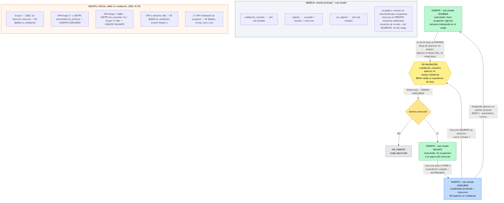

# Sprint — Estado y Sub-estado del Cargo (ciclo de vida de la vacante)

> Plan acordado con Jorge (2026-10-29). Formaliza el ciclo de vida del cargo, agrega el
> sub-estado **Concurso**, y deja el backfill inicial sobre los cargos hoy en validación.
> El backfill (datos) lo corre Jorge en Neon con el SQL que acompaña este plan; el código
> (migración + endpoint + UI) lo ejecuta un workflow.



---

## 1. Modelo de estados (decisión: estado + sub-estado separados — Opción A)

El cargo tiene un **estado principal** y, cuando está `vigente`, un **sub-estado**:

```
ESTADO PRINCIPAL        SUB-ESTADO (solo si vigente)
─────────────────       ────────────────────────────
validacion_vacante      —
vigente                 ocupado | vacante | concurso
no_vigente              —
```

Esto refleja lo que el **exportable de /cargos** ya muestra (columna Estado + Situación) y es una
necesidad de la regla de negocio.

### Cómo se determina el sub-estado de un cargo vigente (A1-corregido)

Los tres sub-estados son **MUTUAMENTE EXCLUYENTES**: un cargo vigente tiene **exactamente uno**
en cada momento. Para pasar a otro, debe **abandonar** el que tenía. No puede existir un cargo
"ocupado y en concurso" a la vez — un cargo en concurso es, por definición, uno que ya fue
vaciado (se cargó la baja de la persona; pasó ocupado → vacante → concurso).

**Decisión: `subEstado` es una columna PERSISTIDA con los 3 valores** `{ ocupado, vacante, concurso }`,
siempre exactamente uno cuando `estado = vigente` (y null cuando el cargo es `validacion_vacante`
o `no_vigente`). NO es un cálculo: es una **máquina de estados explícita** que las transiciones
mueven de un valor al otro, garantizando la exclusividad por construcción (no por precedencia de
cálculo, que escondería inconsistencias).

Secuencia obligada del sub-estado:

```
ocupado --(baja de la persona)--> vacante --(concurso Etapa 2)--> concurso --(designado en padron)--> ocupado
```

- `ocupado` se setea cuando el designado entra al padrón (coherente con que exista ocupación vigente).
- `vacante` se setea al validar la baja con "genera concurso = sí".
- `concurso` se setea cuando el concurso pasa a Etapa 2.

> **Situación de revista** (activo / comisionado / retenido) es del **OCUPANTE**, vive en la
> ocupación — NO es estado del cargo y no se mezcla acá.
>
> **Invariante a garantizar:** un cargo con `subEstado='concurso'` NO puede tener ocupación
> vigente; uno con `subEstado='ocupado'` DEBE tener ocupación vigente. El backfill y las
> transiciones deben respetarlo; conviene un chequeo de consistencia post-backfill.

---

## 2. Transiciones del ciclo de vida

1. **Vigente ocupado → En validación**
   Se da de baja la PERSONA (deja de aparecer en el padrón, aparece en Bajas SIAL, se carga la
   baja en el sistema). El cargo queda `validacion_vacante`. Aparece en `/bajas/validacion`.

2. **En validación → (según "¿genera concurso?")**
   Al cargar/validar el expediente de baja declarado, el sistema pregunta **¿genera concurso?**:
   - **NO** → `no_vigente` (cargo deprecado).
   - **SÍ** → `vigente` / sub-estado **vacante** (a la espera del concurso).

3. **Vigente vacante → Vigente concurso**
   El concurso pasa a **Etapa 2**: ya tiene el **expediente de concurso cargado** y fue
   **autorizado** (validado por supervisores). Recién ahí el cargo pasa a sub-estado `concurso`.
   Tener el expediente cargado sin autorizar (Etapa 1) NO cambia el sub-estado.

4. **Concurso desierto → En validación**
   Si el concurso queda **desierto** (`q-desierto`), vuelve automáticamente a Etapa 1: necesita
   autorización de nuevo. El cargo vuelve a `validacion_vacante`.

5. **Vigente concurso → Vigente ocupado** (PASO 2 — automático, FUERA de este sprint)
   Cuando el concurso llega a la última etapa, hay designado y esa designación aparece ocupando
   el cargo en la dotación semanal → el cargo pasa a `vigente` ocupado (se deriva solo al existir
   la ocupación; además hay que limpiar `subEstado`). Las transiciones automáticas (hooks en carga
   de concurso/baja/padrón) son el **Paso 2**, no se implementan ahora.

### Definición del corte "Etapa 2" por tipo de concurso

- **CPH** (`concursos_cph.sub_estado`): Etapa 2 = desde **`a-autzn`** (autorización) en adelante.
  - Etapa 1 (todavía NO concurso): `no_iniciado`, `a-caratulado`.
  - `q-desierto` → vuelve a validación (regla 4), NO cuenta como concurso.
  - `finalizado` → ver sección 4 (se revisan aparte).
- **CEETPS** (`concursos_ceetps.estado`): Etapa 2 = `autorizado`, `en_proceso`.
  - Etapa 1: `sin_autorizar`.
  - `finalizado`, `desierto` → ver secciones específicas.

---

## 3. Backfill inicial (TODOS los cargos, no solo validación)

Como `subEstado` pasa a ser persistido, el backfill debe setearlo en **todos los cargos vigentes**,
no solo los de validación. Estado medido en Neon el 2026-10-29: ~49.571 vigentes + 3842 en validación.

### 3.1 — Cargos ya `vigente` (setear subEstado)

| Cargo vigente                                       | subEstado |
| --------------------------------------------------- | --------- |
| con ocupación vigente (`ocupaciones.hasta IS NULL`) | `ocupado` |
| sin ocupación vigente                               | `vacante` |

### 3.2 — Cargos hoy en `validacion_vacante` (3842): resolver estado + subEstado

| Situación del cargo                                                             | Cargos      | Destino backfill                                                 |
| ------------------------------------------------------------------------------- | ----------- | ---------------------------------------------------------------- |
| **Grupo 1** — sin baja, sin concurso (padrón dejó de reportar)                  | 2282        | **se queda** en `validacion_vacante` (subEstado null)            |
| **Grupo 4** — baja cargada, sin concurso                                        | 140         | → `vigente` / `subEstado='vacante'`                              |
| CPH concurso Etapa 2+ (`a-autzn` en adelante, sin `q-desierto` ni `finalizado`) | ~ (ver SQL) | → `vigente` / `subEstado='concurso'`                             |
| CEETPS concurso `autorizado` / `en_proceso`                                     | 384         | → `vigente` / `subEstado='concurso'`                             |
| CPH concurso Etapa 1 (`no_iniciado` + `a-caratulado`)                           | 280         | → `vigente` / `subEstado='vacante'`                              |
| CEETPS `sin_autorizar`                                                          | 3           | → `vigente` / `subEstado='vacante'`                              |
| CPH `q-desierto`                                                                | 46          | **se queda** en `validacion_vacante` (vuelve a Etapa 1)          |
| CPH `finalizado` sin ocupante (`m-reso a la firma` 18 + `h-tad` 3)              | 21          | **se queda** en `validacion_vacante` — revisar uno a uno después |

> El SQL del backfill calcula los conteos exactos de CPH Etapa 2 en vivo. Total CPH Etapa 2 ≈
> 1033 − 280 Etapa1 − 46 desierto − 21 finalizado.
>
> **Orden del backfill**: primero 3.2 (resolver los de validación a su estado/subEstado final),
> después 3.1 (setear subEstado a los que quedan vigentes, incluidos los recién promovidos).
> Los cargos que pasan a `subEstado='concurso'` por 3.2 NO deben estar ocupados (verificado: los
> 1399 en concurso tienen 0 ocupados hoy) — respeta el invariante de exclusividad.

### 3.3 — Chequeo de consistencia post-backfill (obligatorio, debe dar 0 en ambas filas)

```sql
SELECT 'concurso_ocupado' AS problema, COUNT(*) FROM cargos c
  WHERE c.deleted_at IS NULL AND c.sub_estado='concurso'
    AND EXISTS (SELECT 1 FROM ocupaciones oc WHERE oc.cargo_id=c.id AND oc.hasta IS NULL)
UNION ALL
SELECT 'ocupado_sin_ocupacion', COUNT(*) FROM cargos c
  WHERE c.deleted_at IS NULL AND c.sub_estado='ocupado'
    AND NOT EXISTS (SELECT 1 FROM ocupaciones oc WHERE oc.cargo_id=c.id AND oc.hasta IS NULL);
```

---

## 4. Casos a revisar aparte (NO se tocan en este sprint)

- **21 CPH `finalizado` sin ocupante**: concursos que cerraron pero el cargo no está ocupado.
  Jorge los revisa uno a uno (¿desierto mal marcado? ¿designado que no entró al padrón aún?).

---

## 5. Alcance de desarrollo (lo que ejecuta el workflow)

### Backend

1. **Migración Prisma**: columna `subEstado` en `cargos`, enum `SubEstadoCargo { ocupado, vacante, concurso }`
   (nullable: null cuando el cargo NO es `vigente`). NO agregar valores al enum `EstadoCargo`
   (el modelo es estado + sub-estado, los 3 sub-estados son mutuamente excluyentes).
2. **Dejar de inferir ocupado/vacante por la ocupación**: pasar a leer `subEstado` persistido.
   Buscar todos los call sites que hoy calculan "ocupado/vacante" en runtime (listados, export,
   detalle, filtros) y migrarlos a la columna. El exportable de /cargos debe reflejar el subEstado.
3. **`GET /api/v1/bajas/validacion`**: ya filtra `estado='validacion_vacante'`; con el backfill,
   los que pasaron a vigente dejan de aparecer naturalmente. Verificar.
4. **Invariante**: nunca `subEstado='concurso'` con ocupación vigente, nunca `'ocupado'` sin
   ocupación vigente (ver chequeo 3.3). Las transiciones del Paso 2 lo mantienen.

### Frontend

4. **Pestaña de clasificación**: separar **CPH** y **CEETPS** en pestañas distintas.
5. **Mostrar sub-estado** (ocupado/vacante/concurso) donde se muestra el estado del cargo
   (CargosPage, exportable, detalle). Alinear con la columna del exportable de /cargos.

### Verificación

- Build de api y web en verde (`pnpm --filter @srrhh/api build`, `pnpm --filter @srrhh/web build`).
- NO ejecutar nada contra la DB desde el workflow. El backfill lo corre Jorge en Neon.

---

## 6. Paso 2 (futuro, fuera de este sprint)

Transiciones automáticas por hooks:

- carga/validación de concurso a Etapa 2 → sub-estado `concurso`.
- concurso desierto → vuelve a `validacion_vacante`.
- designado aparece en padrón semanal → `vigente` ocupado (limpiar `subEstado`).
- alta por baja con "¿genera concurso?" → no_vigente / vigente vacante.
