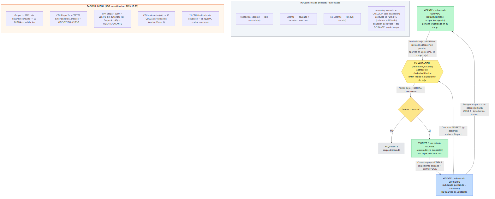

# Sprint — Expansión de Incidencias (monitoreo del ciclo de vida del cargo)

> Plan acordado con Jorge (2026-11-04). Convierte el módulo **Incidencias** (`/incidencias`) en
> la vista única donde el usuario ve y gestiona los "grises" de la dotación: en cada nueva carga
> de **baja SIAL** + **padrón semanal**, el sistema detecta qué cambió en cada cargo gestionable
> respecto a su estado anterior y lo agrupa por tipo de incidencia en pestañas.
> Reemplaza la pantalla vieja `/bajas/validacion` (se toman conceptos, no el modelo).
>
> **Estado al 2026-11-04:** investigación de código ✅ (`.agents/tasks/investigate-incidencias/report.md`);
> diseño en curso (workflow `incidencias-expansion`, `.agents/tasks/incidencias-expansion/design.md`).
> NADA implementado todavía — este sprint es la planificación de fondo. Las decisiones de negocio
> de abajo son de Jorge y son fuente de verdad (también en la memoria `ciclo-vida-cargo-clasificacion`).

---

## 1. Visión

Incidencias deja de ser "la cola de id_sial nuevos" y pasa a ser un **monitor de la totalidad de los
cargos gestionables**. Cada vez que entra una baja SIAL nueva y un padrón nuevo, el sistema compara
el estado anterior de cada cargo contra el nuevo (cruzado con el padrón anterior y el nuevo) y
genera incidencias por tipo de cambio. El usuario las revisa y decide (declarar baja, generar
concurso, declarar incierto, declarar no vigente, etc.).

**Orden de carga real (clave):** PRIMERO se cargan las **bajas SIAL**, DESPUÉS el **padrón**. El
sistema sabe quién se fue de baja antes de que el padrón lo refleje. Entre ambas cargas hay una
ventana donde la baja ya se conoce pero el padrón aún muestra a la persona.

---

## 2. Decisiones de negocio (Jorge, 2026-11-04 — fuente de verdad)

1. **Universo gestionable (definición definitiva, Jorge).** Un cargo es gestionable si:
   `codigo IN ('37','22','23','85','87')` **OR** (`codigo = '83'` **AND** literal de puesto
   normalizado ∈ Anexo II — los 9 literales). Es decir: **códigos plenos 37/22/23/85/87** (entran
   enteros) **más el código 83 SOLO en sus puestos del Anexo II**, detectados por literal de puesto
   (opción b por literal, elegida por Jorge). **El código 60 SALE** (ya no es gestionable) y el
   **83 ya no entra entero**. Residencias (24) y Docentes (07) quedan FUERA. NO es "todo menos
   Residencias/Docentes" (ese era el criterio aproximado de KPIs); es esta definición explícita.
   **Ver todos vs. gestionar estos:** el sistema NECESITA VER todos los cargos de la dotación; los
   gestionables son solo aquellos sobre los que generamos bajas, concursos y nuevos cargos. Por eso
   **Incidencias filtra ESTRICTO** (solo cargos gestionables, que son los accionables) y el
   **Reporte de Indicadores NO filtra** (muestra TODOS los cargos, dotación completa).
   **Hoy Incidencias NO aplica ningún filtro de carrera → es un bug a corregir.**

2. **Histórico del padrón DENSO.** Hoy `padron_historico` solo guarda los roles con diff de la
   semana. Se cambia para que cada aprobación guarde el estado de TODA la dotación gestionable viva,
   acumulándose semana a semana. Permite detectar "cayó del padrón" y "reapareció" leyendo el
   histórico, sin congelar estados aparte. (~49k filas/semana del universo completo; evaluar
   acotar al subuniverso gestionable para bajar volumen.)

3. **Situación de revista** viene del padrón semanal: `activo` / `comisión` / `retención`. Es la
   base del flujo de **concurso por retención de cargo** (un cargo en retención es elegible para
   concurso por reemplazante; ver `cargos.tipoOrigen` `R`/`TTR` y `cargoRetenidoId`).

4. **Campo `estado_persona` → se reemplaza por `situacion_revista`.** Jorge: "es lo mismo y ya no
   deberíamos usarlo". OJO: en datos NO es duplicado exacto — `estado_persona` trae `Bloqueado`
   (151 filas) que no existe en `situacion_revista`, y hay desalineaciones. Antes de reemplazar hay
   que listar todos los usos y decidir qué pasa con `Bloqueado` (no perder su significado si lo tiene).

5. **Cadena de datos:** PERSONA → `id_sial` → ROL (ocupación, `id_sial_rol = {id_sial}-{n}`) →
   PUESTO → CARGO. Una persona (un `id_sial`, ej. `00159159`) puede tener varios roles
   (`00159159-1` activo, `00159159-2` retenido), cada uno una ocupación con su situación de revista.
   Como el `id_sial_rol` incluye el CUIL, un cambio de persona en el mismo legajo se ve como rol
   nuevo + rol viejo; para detectarlo hay que seguir la cadena / usar `roles_persona`.

6. **El SIAL gobierna el PUESTO; nuestro sistema gobierna el CARGO.** Los valores de puesto y
   especialidad que trae el padrón son del PUESTO (gobernanza SIAL). Los datos del CARGO los
   gobierna el sistema. La pestaña "Cambios del puesto" mide cambios en la info del PUESTO, no del
   cargo.

7. **Incidencias NO lleva permisos por pestaña (`tab:*`).** Las pestañas son vistas, no
   funcionalidades (se quitaron los `tab:*` en el commit `c3cf0cf`). Las pestañas nuevas se muestran
   a quien tenga `incidencias/ver`.

---

## 3. Pestañas (7)

| #   | Pestaña                            | Estado    | Qué detecta                                                                                                                                                              |
| --- | ---------------------------------- | --------- | ------------------------------------------------------------------------------------------------------------------------------------------------------------------------ |
| 1   | **SIAL sin cargo**                 | ✅ existe | id_sial en el padrón sin cargo en el sistema (= "cargo nuevo" gestionable).                                                                                              |
| 2   | **Baja sin concurso**              | ✅ existe | Cargo gestionable que cayó del padrón / está en validación, sin concurso.                                                                                                |
| 3   | **Cayó del padrón**                | 🆕        | Estaba el período anterior, ya no está, sin baja SIAL que lo explique.                                                                                                   |
| 4   | **Cambió la situación de revista** | 🆕        | Misma persona, cambió activo/comisión/retención. Importante: retención → elegible para reemplazante.                                                                     |
| 5   | **Cambios del puesto**             | 🆕        | Cambió la info del PUESTO (puesto/especialidad, gobernado por el SIAL), no del cargo.                                                                                    |
| 6   | **Otras incidencias**              | 🆕        | Agrupa casos raros: nueva baja detectada (en baja SIAL pero el padrón aún no la bajó), cambió la persona (CUIL distinto), reapareció (volvió al padrón tras validación). |
| 7   | **Validación**                     | ✅ existe | Se deja.                                                                                                                                                                 |

Las 2 existentes usan el patrón **HECHOS (SQL) → clasificación PURA → ítem** en
`incidencias.clasificacion.ts` / `incidencias.tipos.ts`. Agregar pestaña = objeto en
`incidencias.tipos.ts` + entrada en `TABS_INCIDENCIAS` del web (sin permiso `tab:*`, ver decisión 7).

---

## 4. Arquitectura (del informe de investigación)

- **Punto de comparación:** `aprobarSnapshotService` (`apps/api/src/modules/padron/padron.service.ts`)
  corre 11 pasos en una `$transaction`. El estado del cargo recién queda estable tras el **paso 11**
  (recálculo de `sub_estado`). La comparación para generar incidencias va en un **paso 12 nuevo**
  (dentro de la transacción tras el paso 11, o post-commit). Comparar antes da falsos positivos
  (normalización, completado de especialidades, reaperturas, fantasmas de jefatura).
- **Persistencia:** el informe recomienda una tabla de incidencias por snapshot; el diseño decide
  entre eso y cálculo on-demand (como `baja-sin-concurso` hoy). Resolver idempotencia ante reaprobación.
- **Filtro gestionable compartido:** helper/CTE con la definición definitiva (plenos 37/22/23/85/87
  - código 83 SOLO Anexo II por literal; ya no son 7 códigos enteros), aplicado también a las 2
    pestañas existentes (hoy sin filtro).
- **Reuso:** `obtenerHechosCandidatos()` (query de HECHOS por cargo) + `clasificarCargo()` (función
  pura). Ampliar los HECHOS con situación de revista anterior/nueva, puesto anterior/nuevo, CUIL
  anterior, señal de reaparición.

---

## 5. Fases de implementación (ordenadas por riesgo)

> El detalle fino sale del diseño en curso (`.agents/tasks/incidencias-expansion/design.md`). Esta
> es la descomposición tentativa; se ajusta cuando el diseño quede APPROVED.

| Fase                                            | Alcance                                                                                                                                                                                                                                                                                                                                | Riesgo   | Toca pipeline del padrón |
| ----------------------------------------------- | -------------------------------------------------------------------------------------------------------------------------------------------------------------------------------------------------------------------------------------------------------------------------------------------------------------------------------------- | -------- | ------------------------ |
| **F1 — Filtro gestionable** ✅ **COMPLETADA**   | Helper/CTE con la definición definitiva (plenos 37/22/23/85/87 + 83 Anexo II por literal; ya no son 7 códigos enteros), aplicado a las 2 pestañas existentes. El reporte de indicadores NO se tocó (muestra todos los cargos, no filtra por gestionable). Commit `8e19ad9`, mergeada a `jorge`, validada en Neon: 42.868 gestionables. | Bajo     | No                       |
| **F2 — Histórico denso**                        | Cambiar el paso 7 de `aprobarSnapshotService` para guardar toda la dotación gestionable viva por snapshot. Migración + índices.                                                                                                                                                                                                        | **Alto** | Sí                       |
| **F3 — Paso 12 + persistencia**                 | Paso de comparación anterior/nuevo + tabla/cálculo de incidencias. Idempotencia ante reaprobación.                                                                                                                                                                                                                                     | **Alto** | Sí                       |
| **F4 — Pestañas nuevas**                        | Cayó del padrón, cambió situación de revista, cambios del puesto, otras incidencias. Patrón existente.                                                                                                                                                                                                                                 | Medio    | No                       |
| **F5 — `estado_persona` → `situacion_revista`** | Investigar usos, resolver `Bloqueado`, reemplazar donde sea seguro.                                                                                                                                                                                                                                                                    | Medio    | Parcial                  |
| **F6 — Reemplazar `/bajas/validacion`**         | Jubilar la pantalla vieja; conservar helpers que usa el pipeline (`particionarValidacionPorIdSial`).                                                                                                                                                                                                                                   | Medio    | No                       |

**Orden sugerido:** F1 → F2 → F3 → F4, dejando F5 y F6 para el final. Las fases de alto riesgo (F2,
F3) tocan el proceso de aprobación del padrón y requieren verificación cuidadosa con datos reales.

---

## 6. Datos a validar con la BD real (los agentes no acceden a Neon)

- Los datos actuales son de **prueba** (casi todos los cargos creados el 2026-09-30). El reporte y
  las incidencias deben calcular todo bien con la BD **real**, en especial al subir una baja SIAL
  nueva y un padrón nuevo.
- Conteo del universo gestionable (plenos 37/22/23/85/87 + 83 Anexo II por literal; validado en
  Neon 2026-11-05: 42.868 gestionables — del código 83: 1.529 Anexo II dentro / 5.328 fuera),
  volumen del histórico denso, valores reales de
  `situacion_revista` / `estado_persona`, y poblamiento de `roles_persona`: todas quedan como
  consultas SQL para que Jorge corra en WSL (`psql "$NEON_DIRECT"`).

---

## 7. Insumos

- Informe de investigación: `.agents/tasks/investigate-incidencias/report.md` (universo gestionable,
  pipeline del padrón, detección por tipo, qué reusar).
- Diseño detallado: `.agents/tasks/incidencias-expansion/design.md` (en curso).
- Diagrama del ciclo de vida del cargo (Jorge): entidades Persona / Rol(ocupación) / Puesto / Cargo.
- Memoria del repo: `ciclo-vida-cargo-clasificacion`.

---

## 8. Estado

- [x] Investigación de código (informe)
- [x] Diseño APPROVED
- [x] F1 — Filtro gestionable (commit `8e19ad9`, mergeada a `jorge`, validada en Neon: 42.868 gestionables)
- [ ] F2 — Histórico denso
- [ ] F3 — Paso 12 + persistencia de incidencias
- [ ] F4 — Pestañas nuevas
- [ ] F5 — `estado_persona` → `situacion_revista`
- [ ] F6 — Reemplazo de `/bajas/validacion`
